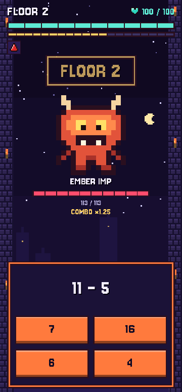
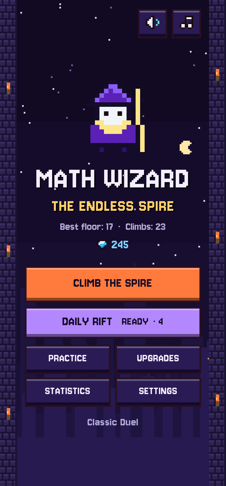
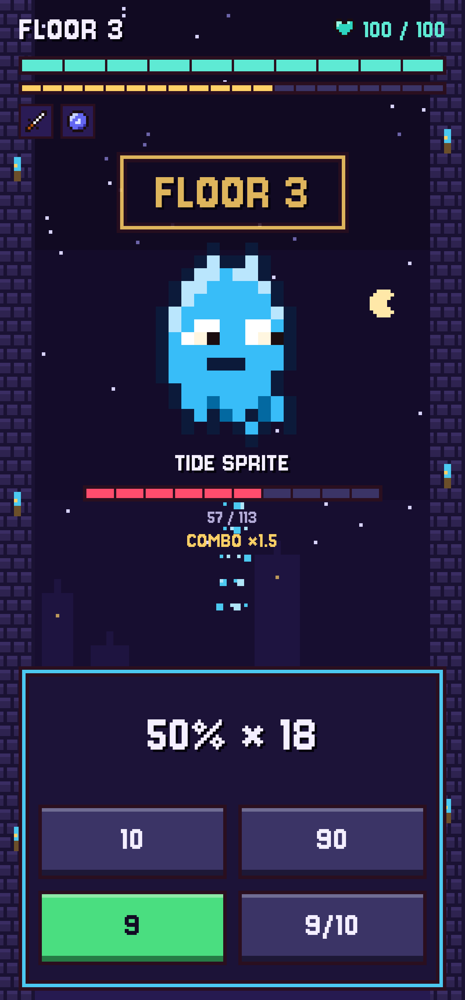
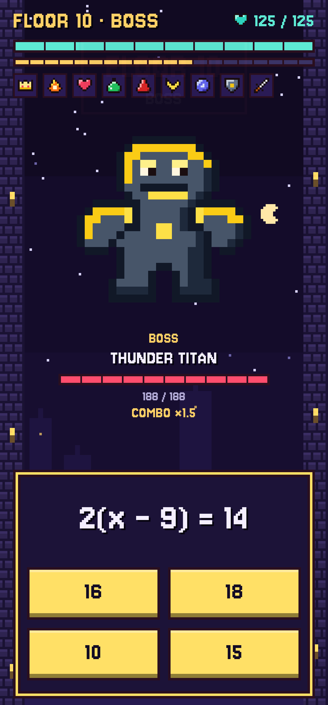
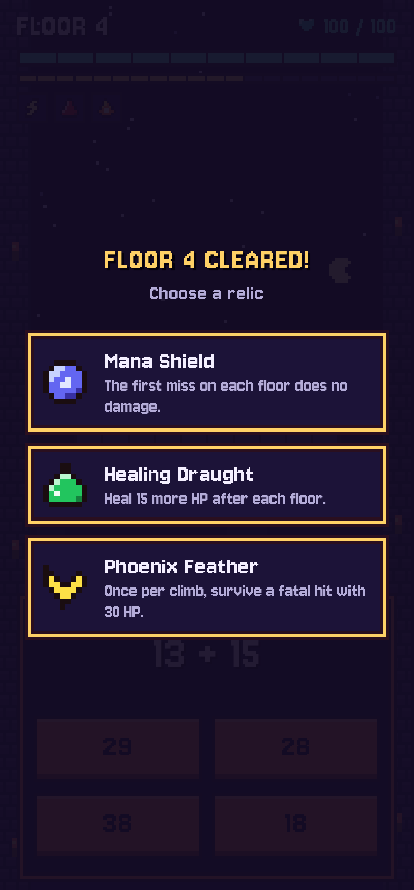
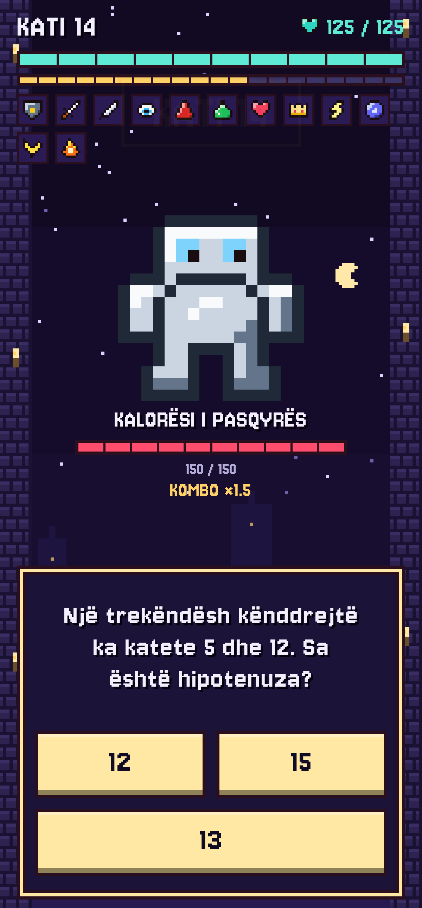
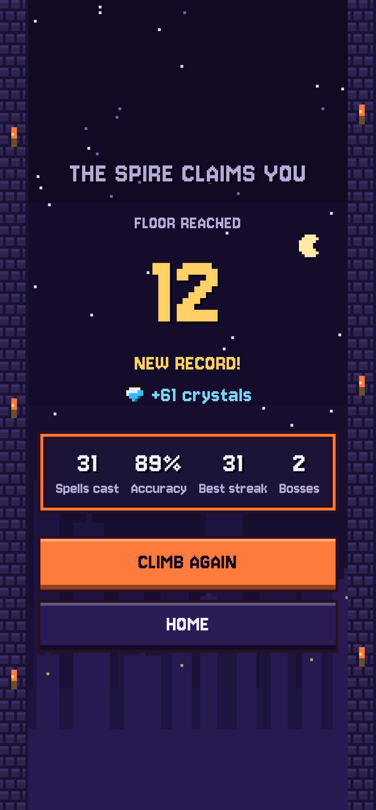
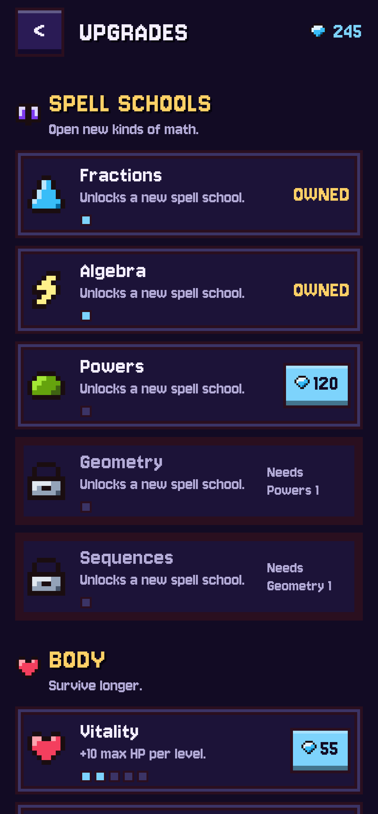
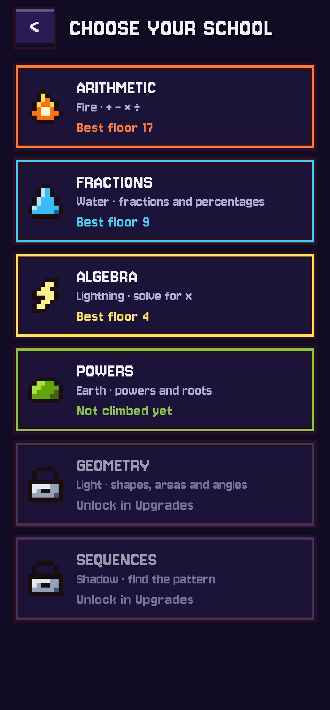

# MathWizard: The Endless Spire

A pixel-art math roguelite for Android. You are a wizard climbing an endless spire: every
solved problem is a spell, fast answers hit harder, and mistakes let the enemy strike back.
Between climbs you spend Mana crystals on permanent upgrades and unlock new spell schools.

**Download:** [arlindo.site](https://arlindo.site) (Android 7.0+, APK outside the Play Store).

<p></p>

<p>
  
  
  
  
</p>
<p>
  
  
  
  
</p>

## Game

- **Endless floors.** Each floor has an enemy; every 5th floor is a boss with multi-step problems.
- **Six spell schools:** Arithmetic, Fractions & percentages, Algebra, Powers & roots, Geometry,
  Sequences, each with its own enemies, boss and colour.
- **Speed and combos.** Answers in the first third of the timer deal ×1.5; streaks add up to ×1.5 more.
- **12 relics** (pick 1 of 3 after each floor) and **7 permanent upgrades** bought with crystals.
- **Adaptive difficulty:** rises with the floor and nudges up or down with your speed and accuracy.
- **Daily Rift:** the same fixed-seed climb for every player each day, one attempt, day streaks.
- **Practice:** any unlocked school at a chosen level, no HP and no timer.
- Albanian and English (switchable in the app), haptics, sound effects and music.

## Accessibility

- Relaxed mode: 75% more time for every problem.
- Theme text colours meet WCAG AA contrast (4.5:1) on every theme background (checked with a
  script); button labels pick the higher-contrast of dark or light text.
- Layouts grow with the system font size (screenshot-tested at 130% and 200%).
- TalkBack: answer buttons, HP bars and relics have labels; the timer bar is hidden to avoid
  constant announcements; the correct answer after a miss is announced.
- Every answer can be read without colour: the correct answer is also shown as text.

## Tech

- Kotlin, Jetpack Compose (single Activity, Navigation), MVVM with `ViewModel` + `StateFlow`.
- `:engine` is a pure Kotlin module with all game rules: seeded problem generators, difficulty,
  run loop, relics, meta progression. Deterministic for a given seed.
- Room for runs, crystals and upgrades (schema migrations tested); offline, no ads, no accounts.
- Pixel art is drawn in Compose from character grids (`ui/pixel/Sprites.kt`), no image assets.
- Tests: engine unit tests (each school's answers checked by an independent evaluator),
  a balance simulation with bot players, ViewModel tests, Robolectric repository and
  migration tests, Roborazzi screenshot tests (also used for the images and the GIF above).

```bash
./gradlew :engine:test testDebugUnitTest      # all tests (JDK 17 or 21)
./gradlew recordRoborazziDebug                # re-record docs/screenshots
python3 tools/preview_sprites.py sheet.png    # render every sprite to one PNG (needs Pillow)
python3 tools/gen_sounds.py                   # regenerate the sound effects and music
python3 tools/make_demo_gif.py                # docs/demo.gif from the demoFrames test
```

Design notes and decisions: [docs/DESIGN.md](docs/DESIGN.md).

## Credits

- Font: [Jersey 10](https://github.com/scfried/soft-type-jersey) by The Soft Type Project Authors,
  SIL Open Font License 1.1 ([licenses/Jersey10-OFL.txt](licenses/Jersey10-OFL.txt)).
- Sound effects and music: synthesised by [tools/gen_sounds.py](tools/gen_sounds.py) for this
  project (square, triangle and noise waves), no third-party samples.
- Pixel art: drawn for this project.

## Building a release APK

1. Generate a signing key once (keep the `.jks` file and its passwords safe):

   ```bash
   keytool -genkeypair -v -keystore mathwizard-release.jks \
     -alias mathwizard -keyalg RSA -keysize 2048 -validity 10000
   ```

2. Copy `keystore.properties.example` to `keystore.properties` and fill in the real values
   (git-ignored, never commit it).

3. `./gradlew assembleRelease`. The signed APK lands in `app/build/outputs/apk/release/`.
